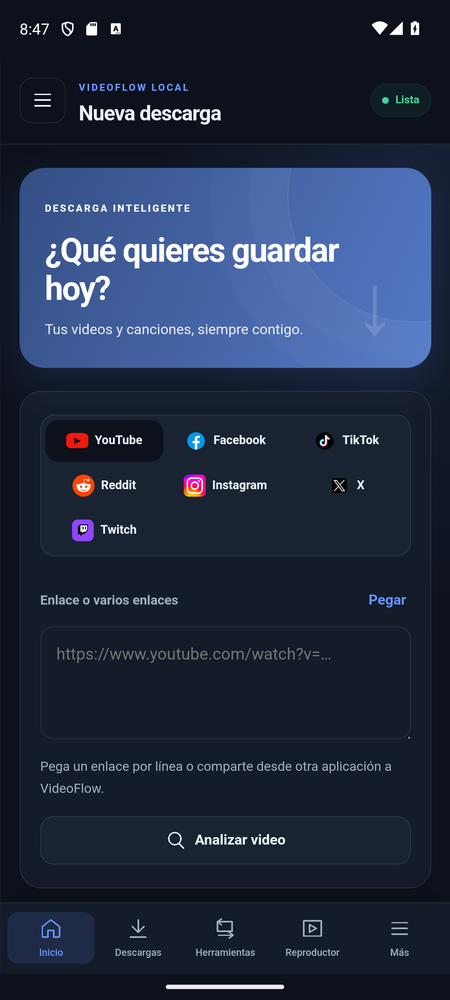
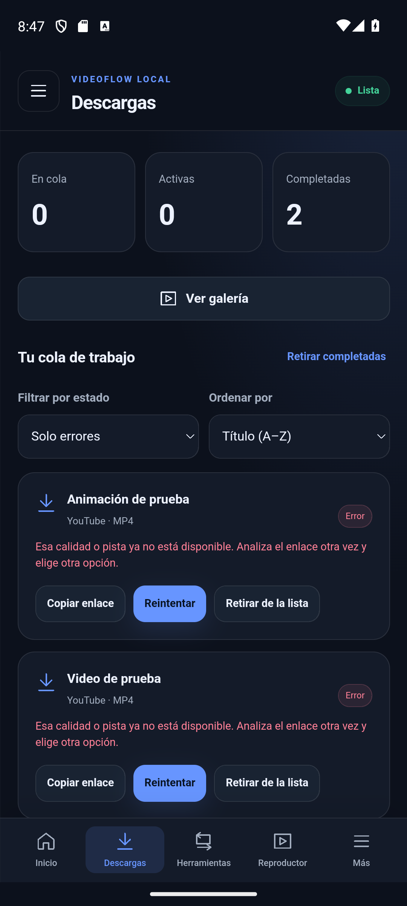
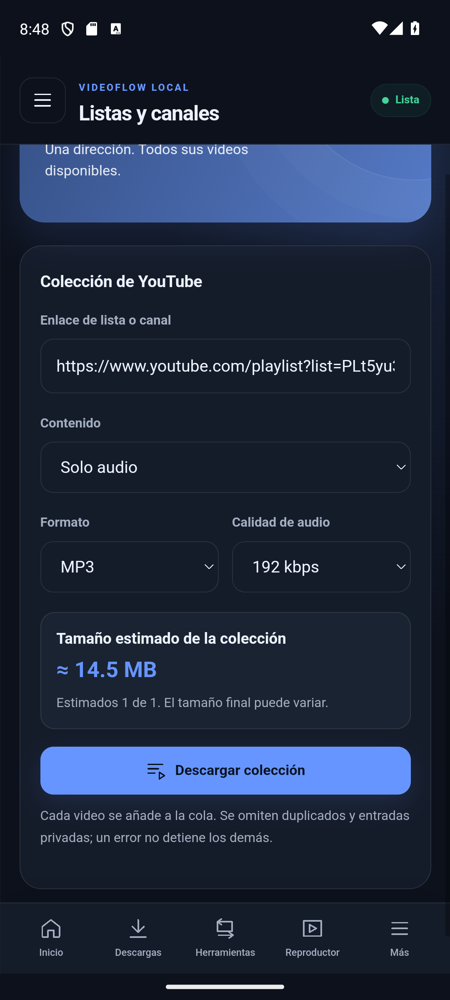

<div align="center">
  
  <h1>VideoFlow Local para Android</h1>
  <p>Descarga, convierte y reproduce video y audio en tu celular.</p>
  <p>
    <a href="https://github.com/Marco035xd/VideoFlow-Local-Android/releases/latest"></a>
    
    <a href="LICENSE"></a>
  </p>
  <p><a href="https://github.com/Marco035xd/VideoFlow-Local-Android/releases/latest"><strong>Descargar APK</strong></a></p>
  <p>
    <a href="#capturas">Capturas</a> ·
    <a href="#funciones">Funciones</a> ·
    <a href="#instalación">Instalación</a> ·
    <a href="#compilación">Compilación</a> ·
    <a href="https://github.com/Marco035xd/VideoFlow-Local">Windows</a>
  </p>
</div>

## Capturas

<table>
  <tr>
    <td width="33%" align="center" valign="top">
      <a href="docs/01-inicio.png"></a><br>
      <strong>Inicio</strong>
    </td>
    <td width="33%" align="center" valign="top">
      <a href="docs/05-descargas.png"></a><br>
      <strong>Descargas</strong>
    </td>
    <td width="33%" align="center" valign="top">
      <a href="docs/06-colecciones.png"></a><br>
      <strong>Listas y canales</strong>
    </td>
  </tr>
</table>

[Ver Apariencia](docs/02-apariencia.png) · [Ver Reproductor](docs/03-reproductor.png) · [Ver Picture-in-Picture](docs/04-pip.png)

## Funciones

| Área | Qué puedes hacer |
| --- | --- |
| **Descargas** | Guarda videos de YouTube, Facebook, TikTok, Reddit, Instagram, X y clips de Twitch. Pega varios enlaces o usa **Compartir → VideoFlow Local**. |
| **Listas y canales** | Importa colecciones de YouTube. El tamaño estimado aparece al pegar el enlace y se actualiza según el contenido, formato y calidad elegidos. Si faltan datos, se muestra un subtotal. |
| **Cola** | Filtra por **Solo errores** o **Completadas**, ordena por fecha o título y copia el enlace original desde la tarjeta. Puedes reintentar trabajos y restaurar los retirados sin descargarlos de nuevo. |
| **Formatos y pistas** | Elige la resolución y la pista de audio disponible, con salida de video en MP4, MKV, WebM, MOV o AVI, y de audio en MP3, OGG Vorbis, M4A, FLAC, WAV u Opus. |
| **Archivos locales** | Convierte o comprime varios archivos en tu celular y consérvalos en **Descargas / VideoFlow**. Encuentra tus videos en la galería o el historial. |
| **Reproducción y apariencia** | Reproduce archivos con Picture-in-Picture, personaliza temas, fondos y perfil, y cambia el idioma a español, inglés o portugués. |

## Instalación

1. En la [última publicación para Android](https://github.com/Marco035xd/VideoFlow-Local-Android/releases/latest), abre **Assets** y elige tu APK.
2. Ábrela en un celular con **Android 10 o posterior** y sigue el asistente de instalación.

| APK | Para qué equipo |
| --- | --- |
| **ARM64** | La mayoría de los celulares Android actuales. |
| **ARM32** | Dispositivos con procesador ARM de 32 bits. |
| **Universal** | Incluye las variantes ARM64, ARM32 y x86_64. Úsala si desconoces la arquitectura. |

Las APK se publican firmadas y acompañadas de `SHA256SUMS.txt`.

## Uso rápido

1. En **Inicio**, pega un enlace y toca **Analizar video** para ver la información, las calidades y las pistas disponibles.
2. Elige el resultado y toca **Añadir a Descargas**. Para descargar un lote, pega un enlace por línea.
3. Para una colección de YouTube, abre **Listas y canales** y revisa la estimación antes de tocar **Descargar colección**.

VideoFlow procesa los trabajos en el dispositivo. Si un sitio solicita verificar tu acceso, puedes importar un archivo propio de sesión desde **Configuración → Importar cookies.txt**.

## Compilación

Usa **JDK 17** y el **Android SDK con plataforma 35**. Abre el proyecto en Android Studio o ejecuta [`CREAR_APK.ps1`](CREAR_APK.ps1) desde PowerShell en Windows.

```powershell
.\CREAR_APK.ps1
```

El script compila, firma y ejecuta Android Lint. Las APK y las sumas SHA-256 quedan en `release/`. Conserva de forma privada la clave de `.signing/` para firmar futuras actualizaciones.

## Proyecto

Puedes [reportar un problema en GitHub](https://github.com/Marco035xd/VideoFlow-Local-Android/issues). Consulta la [licencia GPL-3.0](LICENSE) y los [avisos de los componentes incluidos](THIRD_PARTY_NOTICES.md).

Usa VideoFlow Local para guardar contenido propio o que tengas autorización para descargar.
